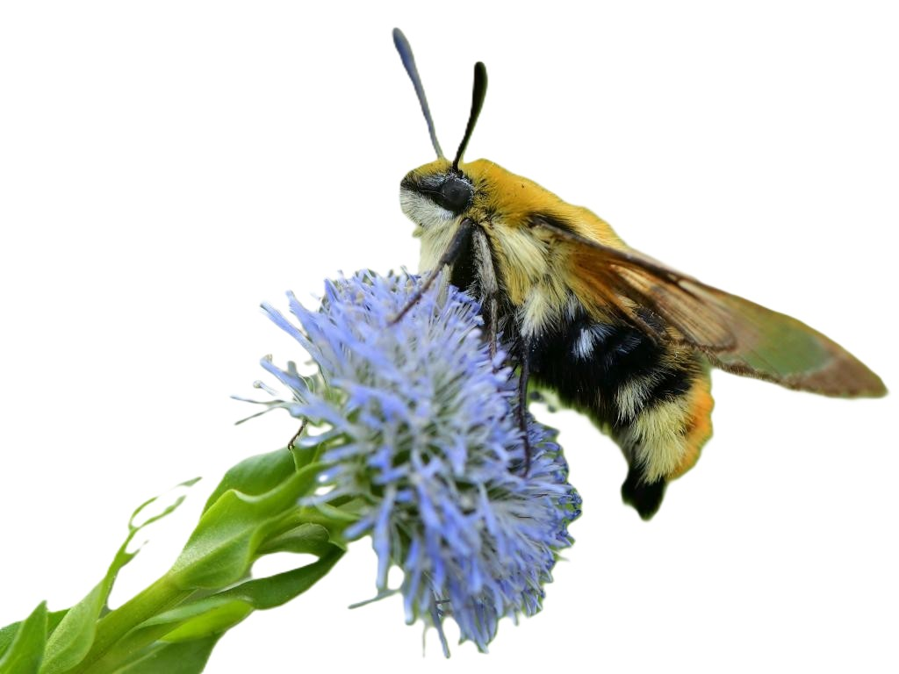

<p align="center">
  
</p>

## BeeHawk
***
[](./LICENSE)


&nbsp; BeeHawk (shorthand for Bee Hawk-moth) is a napari plugin designed
for mass spectrometry imaging (MSI). MSI data is often very dense, 
containing thousands of mass-to-charge (*m/z*) values and requires
substantial pre-processing for downstream analysis, 
let alone viewing.
<br/> 

&nbsp; Furthermore, this processing often loses low-level signals 
that can be biologically significant. Rather than focusing purely 
on spectral reduction, BeeHawk uses spatial reduction via superpixels
to allow the inspection of data from global perspective by aggregating
spectra into distinct regions, averaging results, reducing the number disk reads.

### Structure 
***
```text
BeeHawk/
├── src/
│   └── napari_beehawk/
│       ├── __init__.py
│       ├── _widget.py
│       └── _plotting.py
├── .gitignore
├── LICENSE
├── pyproject.toml
└── README.md
```

### Installation and Launch
***
```commandline
pip install beehawk

napari 
```
#### Editable Version 
```commandline 
git clone https://github.com/Acrington-Stan/BeeHawk

cd BeeHawk

pip install -e
```
If you encounter issues installing the package, check your napari
installation, using `pip install napari[all]`.
### Contributors 
***
Thorne, J.<sup>1,2</sup>, Basham, M.<sup>1</sup>, and French, A.<sup>2</sup> 

### Affiliations 
***
- University of Nottingham<sup> 1 </sup>
- The Rosalind Franklin Institute<sup> 2 </sup>

### Acknowledgements
***
Parts of the GUI design were made with the help of the Mistral AI model
